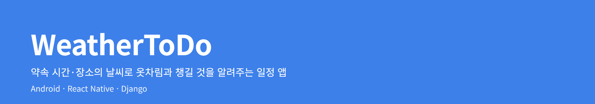
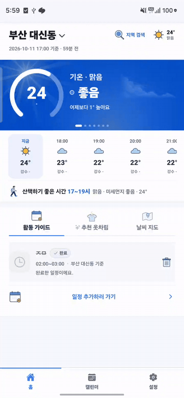
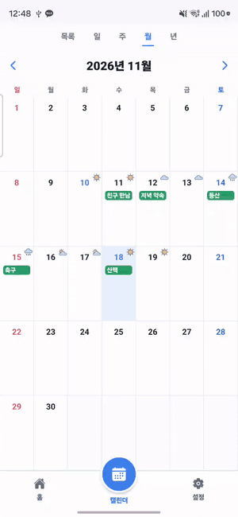
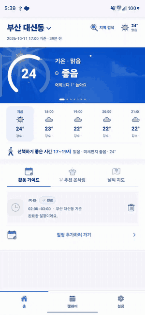

  

# WeatherToDo

일정을 넣으면 **그 시간, 그 장소의 날씨와 미세먼지**를 보여 주고, 입을 옷과 챙길 것까지 알려 주는 안드로이드 캘린더 앱입니다.

## Download app

안드로이드 7.0 이상

## 핵심 기능

| 홈 | 캘린더 | 배너 |
| :---: | :---: | :---: |
|  |  |  |
| 활동 가이드 · 옷차림 · 날씨 지도 | 월 · 년 · 주 · 일 · 목록 | 날씨 · 미세먼지 · 시간별 예보 |

- **일정별 날씨** — 일정마다 그 시간·장소의 날씨, 미세먼지, 비 소식을 함께 표시
- **AI 일정 등록** — "내일 3시 강남역 친구 만남"처럼 적거나 말하면 일정으로 정리
- **옷차림 추천** — 기온·강수·바람·일정 종류로 옷과 준비물 추천
- **날씨 지도** — 전국 측정소의 기온과 미세먼지
- **알림과 위젯** — 아침 브리핑, 곧 비·눈·강풍, 기상특보, 미세먼지 급증, 홈 화면 위젯

## 기술

| 영역 | 사용 기술 |
| --- | --- |
| 앱 | React Native (Expo), TypeScript, Kotlin |
| 서버 | Django, DRF, MySQL, Redis, Gemini |
| 운영 | Google Cloud, nginx, gunicorn, systemd timer |
| 데이터 | 기상청 단기·중기예보, 에어코리아 대기질, 네이버 지역 검색 |
