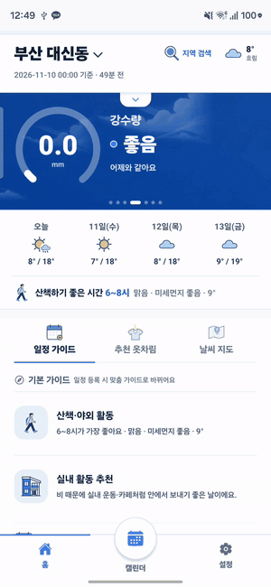
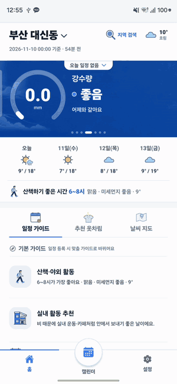
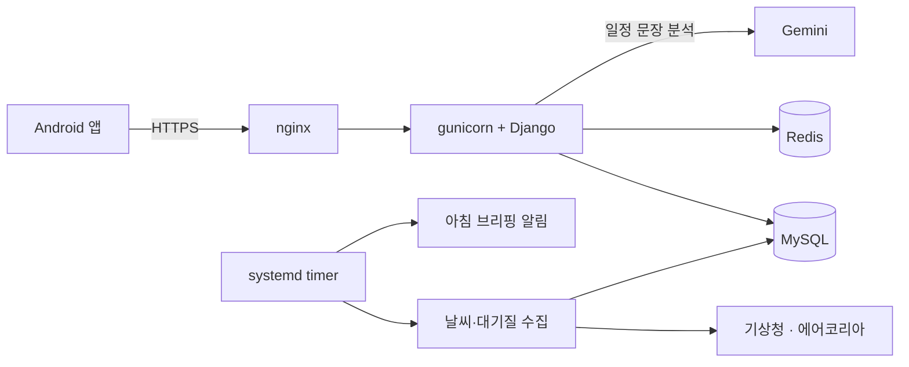

  

**일정을 넣으면 그 시간, 그 장소의 날씨와 미세먼지를 보여 주고, 
입을 옷과 챙길 것까지 알려 주는 안드로이드 캘린더 앱**

 

  

 

| 홈 | 캘린더 | 예보 · 지도 |
| :---: | :---: | :---: |
|  |  |  |
| 배너 · 활동 가이드 · 옷차림 | 월 · 년 · 주 · 일 · 목록 | 시간별 예보 · 전국 날씨 · 미세먼지 |

## 주요 기능

| 기능 | 설명 |
| --- | --- |
| **일정별 날씨** | 일정마다 그 시간·장소의 날씨, 미세먼지, 비 소식을 함께 표시합니다. |
| **AI 일정 등록** | "내일 3시 강남역 친구 만남"처럼 적거나 말하면 일정으로 정리합니다. |
| **옷차림 추천** | 기온, 강수, 바람, 일정 종류를 바탕으로 옷과 준비물을 추천합니다. |
| **날씨 지도** | 전국 측정소의 기온과 미세먼지를 지도에서 봅니다. |
| **알림** | 아침 브리핑, 곧 시작되는 비·눈·강풍, 기상특보, 미세먼지 급증을 알려 줍니다. |
| **홈 화면 위젯** | 앱을 열지 않고 홈 화면에서 바로 확인합니다. |

## 기술 스택

| 구분 | 사용 기술 |
| --- | --- |
| **App** | React Native (Expo), TypeScript, Kotlin |
| **Backend** | Django, Django REST Framework, MySQL, Redis, Gemini |
| **Infra** | Google Cloud VM, nginx, gunicorn, systemd timer |

## 서비스 구성

systemd 타이머가 날씨와 대기질을 주기적으로 수집해 저장하고, 앱은 저장된 자료를 서버에서 받아 일정과 함께 보여 줍니다.

## 프로젝트 구성

| 경로 | 내용 |
| --- | --- |
| `mobile/src/` | 앱 화면, 일정·날씨 기능, 알림, 위젯 |
| `mobile/modules/` | 정확한 알람을 위한 Android 네이티브 모듈 |
| `backend/dust/` | 날씨·미세먼지 API와 수집, 알림 로직 |
| `backend/config/` | Django 설정과 URL |
| `backend/deploy/` | nginx, systemd 등 운영 설정 |
| `assets/readme/` | README에 사용한 이미지 |

## 자료 출처

- 날씨: 기상청 단기·중기예보
- 대기질: 에어코리아
- 장소 검색: 네이버 지역 검색

## 라이선스

[MIT License](LICENSE)
